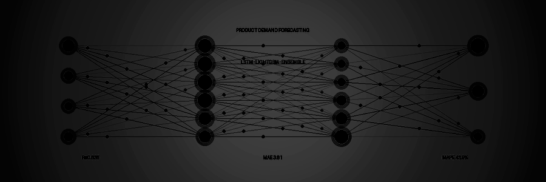
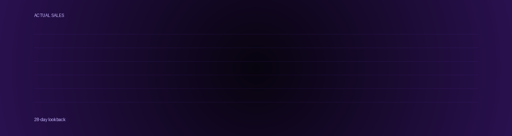
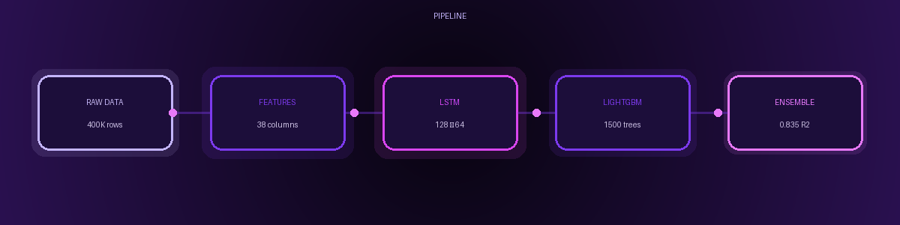
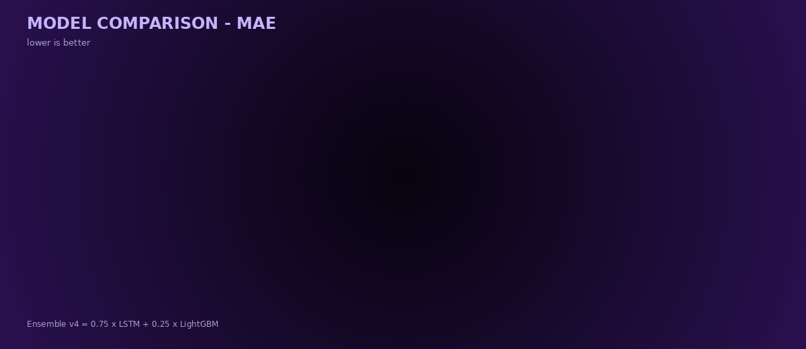
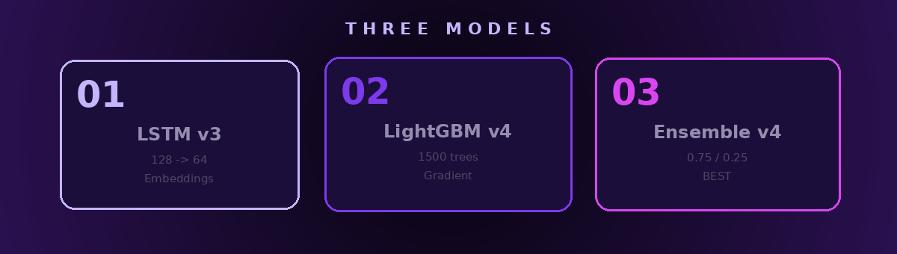

# P R O D U C T |  D E M A N D

<p align="center">
  
</p>

<p align="center">
  <b>LSTM × LIGHTGBM × ENSEMBLE</b><br>
  <sub>train · evaluate · ensemble · deploy</sub>
</p>

<p align="center">
  
  
  
  
</p>

---

## SIGNAL

A production-ready **demand forecasting system** that predicts daily retail sales across **52 products × 10 stores** using a **deep learning ensemble**.

Trained on **5 years** of data (2011–2016) — **400,000+ daily records** — with a **Residual LSTM** network and a **gradient-boosted** companion model, combined into an **optimized ensemble**.

<p align="center">
  
</p>

---

## PIPELINE

<p align="center">
  
</p>

---

## RESULTS

<p align="center">
  
</p>

<table align="center">
  <thead>
    <tr>
      <th align="left">Model</th>
      <th align="center">MAE</th>
      <th align="center">RMSE</th>
      <th align="center">R²</th>
      <th align="center">MAPE</th>
      <th align="center">Score</th>
    </tr>
  </thead>
  <tbody>
    <tr>
      <td>Naive (previous day)</td>
      <td align="center">5.162</td>
      <td align="center">7.764</td>
      <td align="center">0.699</td>
      <td align="center">61.0%</td>
      <td align="center">⬜⬜⬜⬜⬜⬜⬜⬛⬛⬛</td>
    </tr>
    <tr>
      <td>7-day rolling mean</td>
      <td align="center">4.389</td>
      <td align="center">6.643</td>
      <td align="center">0.779</td>
      <td align="center">53.7%</td>
      <td align="center">⬜⬜⬜⬜⬜⬜⬜⬜⬛⬛</td>
    </tr>
    <tr>
      <td>28-day rolling mean</td>
      <td align="center">4.278</td>
      <td align="center">6.457</td>
      <td align="center">0.791</td>
      <td align="center">53.1%</td>
      <td align="center">⬜⬜⬜⬜⬜⬜⬜⬜⬛⬛</td>
    </tr>
    <tr>
      <td>LSTM v3</td>
      <td align="center">3.819</td>
      <td align="center">5.751</td>
      <td align="center"><b>0.835</b></td>
      <td align="center">44.3%</td>
      <td align="center">🟪🟪🟪🟪🟪🟪🟪🟪🟪⬛</td>
    </tr>
    <tr>
      <td>LightGBM v4</td>
      <td align="center">3.905</td>
      <td align="center">5.955</td>
      <td align="center">0.823</td>
      <td align="center"><b>43.6%</b></td>
      <td align="center">🟪🟪🟪🟪🟪🟪🟪🟪⬛⬛</td>
    </tr>
    <tr>
      <td><b>Ensemble v4</b> 🏆</td>
      <td align="center"><b>3.808</b></td>
      <td align="center"><b>5.744</b></td>
      <td align="center"><b>0.835</b></td>
      <td align="center"><b>43.9%</b></td>
      <td align="center">🟪🟪🟪🟪🟪🟪🟪🟪🟪🟪</td>
    </tr>
  </tbody>
</table>

<br>

<p align="center">
  
  
  
</p>

---

## MODELS

<p align="center">
  
</p>

<table align="center">
  <tr>
    <td align="center" width="33%">
      <h3>01 — LSTM v3</h3>
      <sub>Deep residual network</sub><br><br>
      LSTM (128 → 64) + embeddings<br>
      Residual learning · Huber loss<br>
      <b>26 hist + 12 future features</b>
    </td>
    <td align="center" width="33%">
      <h3>02 — LightGBM v4</h3>
      <sub>Gradient-boosted trees</sub><br><br>
      1500 estimators · depth 8<br>
      L1 objective · window aggregates<br>
      <b>Fast & interpretable</b>
    </td>
    <td align="center" width="33%">
      <h3>03 — Ensemble v4 🏆</h3>
      <sub>Weighted combination</sub><br><br>
      0.75 × LSTM + 0.25 × LightGBM<br>
      Optimized on validation MAE<br>
      <b>Best overall</b>
    </td>
  </tr>
</table>

---

## GETTING STARTED

```bash
git clone https://github.com/HdlArf/Product-Demand-Forecasting.git
cd Product-Demand-Forecasting
pip install -r requirements.txt
python app/app.py
```

**Requirements:** Python 3.10–3.12 · ~2 GB disk · 5 minutes setup

---

## STACK

<p align="center">
  
</p>

<p align="center">
  
  
  
  
  
  
  
  
  
</p>

---

## PROJECT STRUCTURE

```
Product-Demand-Forecasting/
  ├── app/
  │   └── app.py                    Desktop application (PySide6)
  ├── data/
  │   └── master_data.parquet       Historical sales (400K rows)
  ├── models/
  │   ├── Product_Demand_LSTM_v3.keras
  │   ├── Product_Demand_LGBM_v4.pkl
  │   ├── Product_Demand_Ensemble_v4.pkl
  │   └── ...
  ├── assets/                       Animated GIFs
  ├── requirements.txt
  └── README.md
```

---

## EXPLORING NEXT

`Probabilistic Forecasting` · `Temporal Fusion Transformer` · `Explainability (SHAP)`

---

## MIAO APPROVES

<p align="center">
  
</p>

---

## CONNECT

<p align="center">
  <a href="https://github.com/HdlArf"></a>
  <a href="https://www.kaggle.com/hadeelalnomay"></a>
  <a href="https://www.instagram.com/hdl_arf/"></a>
  <a href="https://www.linkedin.com/in/hadeel-hadeel-10a449331/"></a>
  <a href="mailto:hadeelalnomai@gmail.com"></a>
</p>

---

<p align="center">
  <sub>still forecasting.</sub><br><br>
  <b>HΛDΞL</b><br>
  <sub>BUILD · EXPLORE · UNDERSTAND</sub>
</p>
